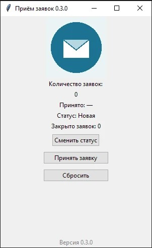
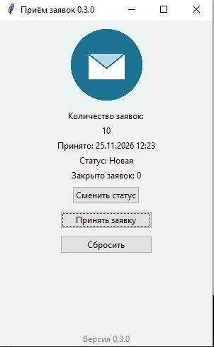
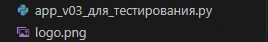
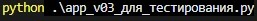
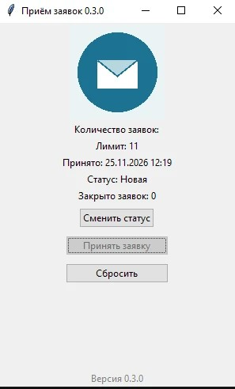
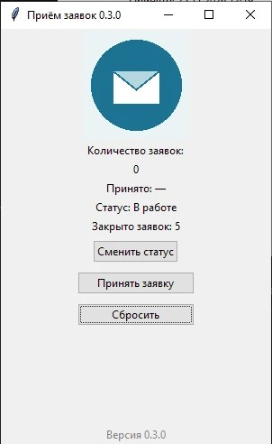

# Приём заявок

Простая программа на Python для подсчёта заявок и смены их статуса.

## Что умеет программа

**Считает новые заявки:** при нажатии на кнопку приёма счётчик увеличивается на 1, а на экране появляется дата и время (`дд.мм.гггг чч:мм`).

**Следит за лимитом:** можно принять максимум 10 заявок. После десятой кнопка блокируется и появляется надпись `Лимит: 10`.

**Меняет статус по кругу:** кнопка смены статуса переключает этапы так: `Новая` → `В работе` → `Готово` → `Новая`.
**Считает готовые задачи:** как только заявка получает статус `Готово`, счётчик закрытых заявок растёт.
**Обнуляет данные:** кнопка сброса стирает счётчик и время, после чего снова можно принимать заявки.
**Удобно выглядит:** кнопки крупные, текст легко читается, а в шапке окна и внизу всегда видна версия программы.

## Как запустить

Для работы нужен Python 3.7 или новее с библиотекой `tkinter`.

Положите картинку `logo.png` в одну папку с файлом `app_v03_для_тестирования.py`. 

Откройте терминал в папке с программой:
Запустите код командой (или откройте файл через любой редактор кода): 

 

## Что нужно исправить

Сейчас программа работает с ошибками и пока не готова к выпуску:

Кнопка приёма блокируется на 11-й заявке вместо 10-й.

Кнопка сброса не обнуляет закрытые заявки и не возвращает начальный статус (`Новая`).

Кнопка смены статуса получилась слишком узкой по сравнению с остальными.
